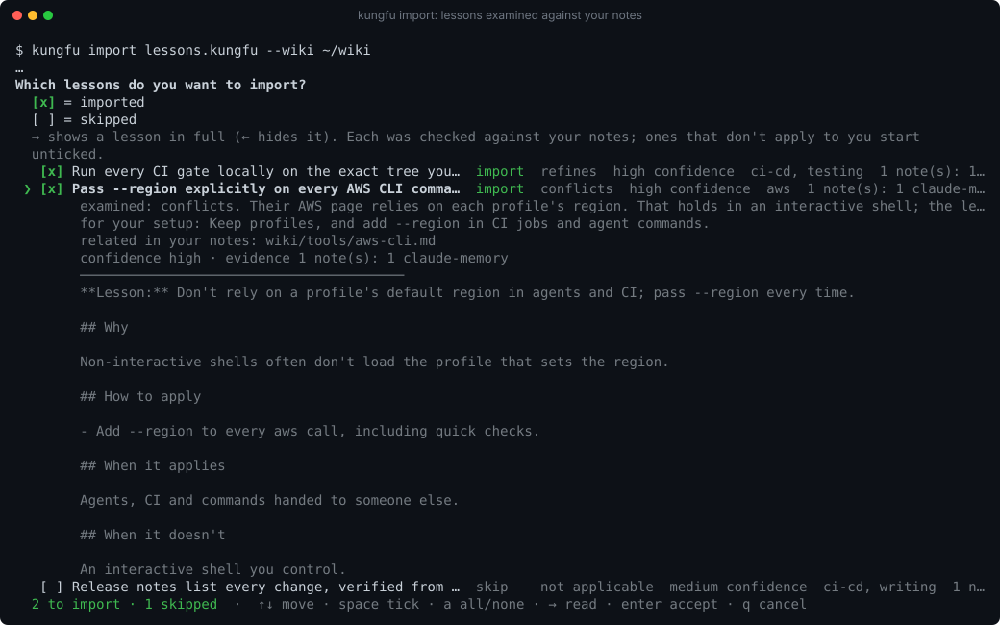
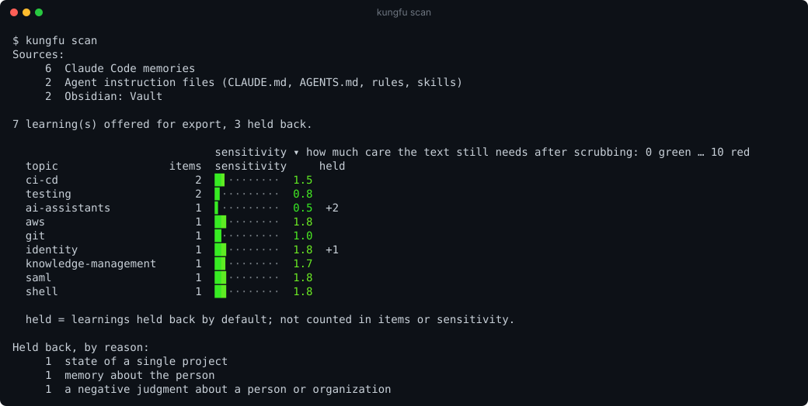
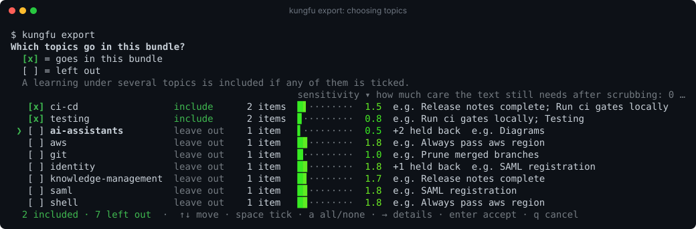
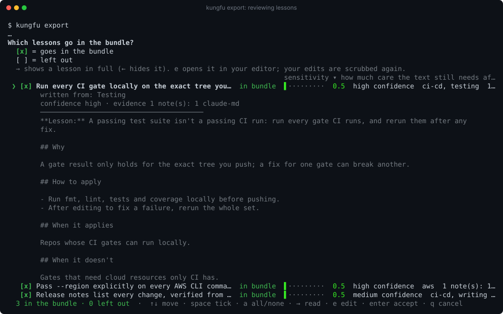

# I Know Kung-Fu



> *"I know kung fu." — "Show me."*

> [!CAUTION]
> **Experimental software. Using it can be risky. Use it at your own risk.**
>
> `kungfu` reads private material (your notes, AI memories and agent instruction files), sends
> excerpts of it to the Anthropic API, writes bundles meant to be given to other people, and writes
> other people's lessons into your knowledge base. Its scrubbing and checks are automated and **can
> miss things or get them wrong**: names, secrets, ID numbers or sensitive context can end up in a
> bundle, and an import can add wrong or harmful advice to your notes. Review everything before you
> share or keep it, make sure you may share what you export, and keep backups.
>
> It is provided **"AS IS", without warranties or conditions of any kind**, and its authors are not
> liable for any harm from using it (see [LICENSE](LICENSE), sections 7 and 8, and [NOTICE](NOTICE)).
> `kungfu init`, `export` and `import` show this warning and run only after you type
> `I accept the risk`, every time (or pass `--accept-risk` for that one run, e.g. in a script).

Turn what you and your AI tools have learned into **lessons** someone else can use, without the
private parts, and check other people's lessons against your own notes before taking them in.

`kungfu` reads your:

- **Claude Code memories** (`~/.claude/projects/*/memory/*.md`)
- **Agent instruction files**: `~/.claude/CLAUDE.md`, and in every git repo under your repo folders
  `CLAUDE.md`, `AGENTS.md`, `GEMINI.md`, `CONVENTIONS.md`, Cursor / Windsurf / Cline / Copilot rules,
  plus Claude Code skills, slash commands and subagents
- **Obsidian vault** (opt-in notes only, see below)
- **Karpathy-style LLM wiki** (`raw/` + `wiki/` + `index.md` + `log.md`): the `wiki/` pages

It splits them into individual *learnings*, scrubs them and tags each with topics. You **choose
topics**, and Claude turns the learnings in them into **lessons**: transferable rules with the
why, how to apply them, and when they do and don't hold. Project details, dates and incidents are
left behind. You review the lessons, and only lessons go in the `.kungfu` bundle.

The recipient **chooses topics**, Claude **examines each lesson against the recipient's own notes**
(new, reinforces, refines, conflicts, or doesn't apply), and the recipient picks which to load into
an Obsidian vault and/or an LLM wiki.



**The Anthropic API is required.** `init`, `export` and `import` check the connection first and
stop with setup instructions if it isn't available. The inspection commands (`scan`, `discover`,
`locate`, `inspect`) work without it.

## Install

```sh
./kungfu --help                  # the first run sets up kungfu's environment with the Anthropic SDK
export ANTHROPIC_API_KEY=…       # or: ant auth login
```

Run it as `./kungfu` from this folder. Homebrew's Python, like most system Pythons, is "externally
managed" and refuses `pip install`, so the first run creates a private virtual environment that holds
kungfu's dependencies (the Anthropic SDK). It lives outside the repo, in
`~/Library/Application Support/i-know-kung-fu/` on macOS (`~/.local/share/i-know-kung-fu/` elsewhere;
set `KUNGFU_VENV` to choose). Keeping it out of the repo matters when the repo is in an
iCloud-synced folder such as `~/Documents`: iCloud would upload it and mark its files hidden, which
newer Pythons ignore. kungfu itself runs straight from `src/`, so edits take effect immediately. The
environment is rebuilt when the dependency list in `pyproject.toml` changes; `./kungfu --reinstall`
rebuilds it by hand. Python 3.11+ is needed to create it.

Requests go to `claude-opus-5-5` (change it under `[distill] model` in the config), using
structured JSON output and server-side fallback: if the model declines a request on a policy
ground, the API retries it on a fallback model within the same call.

## Exporting

```sh
kungfu init          # find names, orgs, projects and topics in your sources; choose what to scrub
kungfu scan          # what was found, what's offered by topic, what's held back and why
kungfu export -o lessons.kungfu --title "Infra habits"
```

`kungfu scan` shows what was found and how sensitive each topic still is after scrubbing:



`export` first shows the topics as a checklist with counts, a sensitivity gauge and examples:



Every list says what a tick means. Under its title, a legend explains both states
(`[x] = scrubbed: replaced with [person] in everything exported`, `[ ] = left as written`). Each
row shows its current effect, which changes as you toggle it, and the counts are outcomes
("1 scrubbed · 3 left as written"):

| List | [x] means | [ ] means |
|---|---|---|
| `init`: folders of git repos | read for learnings | not read |
| `init`: vaults and wikis | exported from | ignored |
| `init`: vault folders | every note is offered, tagged or not | only `#kungfu`-tagged notes |
| `init`: people, orgs, projects, domains, acronyms | scrubbed (replaced with `[person]`, `the organization`, …) | left as written; for one detected automatically, never scrubbed |
| `init`: topics | may be exported | never exported |
| `export`: topics, lessons | goes in this bundle | left out |
| `import`: topics, lessons | imported | skipped |

Every list in `kungfu` works this way: `init`'s folders, vaults, names and topics, and the topic
pickers in `export` and `import`. Use ↑/↓ (or j/k) to move and space to tick or untick. `a`
ticks all or none, → shows the items under a row and ← hides them, and `+` adds your own entry
where that's allowed. Enter accepts; q or Esc cancels without writing anything. Long lists
scroll, and a one-line summary stays behind when you're done. Export starts with nothing
ticked, so you choose what to share; import starts with everything ticked.

Without a terminal (piped input or scripts) the lists take typed commands instead, such as
`1,3-5`, `-2`, `+Name` and `all`. Scripted use: `--topics git,ci-cd` or `--all-topics`, and `-y`,
which skips the questions and the review.

### Lessons

After you pick topics, `export` asks before sending anything. It then sends the scrubbed learnings
in those topics to Claude, grouped by topic. Held-back learnings are never sent. Claude merges
related notes into lessons:

```markdown
**Lesson:** Run every CI gate locally, and rerun them after any fix, before pushing.

## Why
A gate result only holds for the exact tree you push; an edit made to fix one gate can break another.

## How to apply
- …

## When it applies
## When it doesn't
```

Each lesson also carries a **confidence** (high when several notes or a documented incident
support it, low for a single preference) and its **evidence** as counts by source ("3 note(s):
2 claude-memory, 1 claude-md"), never the notes themselves. Notes that seem to disagree ("always
use feature branches", "commit to main on solo repos") become one lesson that states when each
holds. Claude is told to drop people, organizations, projects, paths, dates and ticket or session
IDs. Notes that are only about you, your organization's status or one codebase are skipped, and
`export` lists them with Claude's reasons.

Claude's lessons then go through the same scrubbing and content checks as everything else. You
review them in a checklist: → shows a lesson in full, with the notes it was written from, and `e`
opens it in `$EDITOR` (your edit is scrubbed again).



### Setting up: `kungfu init`

`init` starts by searching your home folder and iCloud Drive for every folder that holds git
repos, and every Obsidian vault and LLM wiki. It offers all of them already ticked, with counts:

```
Which folders of git repos should be read for learnings (CLAUDE.md, AGENTS.md, rules, skills)?
  [x] = read for learnings
  [ ] = not read
   [x] ~/Documents/git              read  48 repos · 23 with your commits
   [x] ~/Documents/work-git         read  31 repos · 27 with your commits
```

The search covers `~` (except `~/Library`) and every container in `~/Library/Mobile Documents`.
It reads folder names only, so iCloud files aren't downloaded. It skips hidden folders, app and
media libraries, VMs and dependency folders, and doesn't descend into repos. On a typical Mac it
takes about a second. A folder counts as a repo folder when it mostly holds repos; a lone repo
in a busy folder like `~/Documents` is offered on its own. `kungfu locate` prints what it finds.
Repos you've never committed to, and that don't share an owner with one you have, are treated
as third-party clones. They aren't read, and their names and owners aren't scrubbed. Set
`only_my_repos = false` to read them anyway.

Next it asks:
- which vault folders, if any, should offer every note rather than only `#kungfu`-tagged ones;
- whether you have former names to save (see below).

Then it reads everything an export could draw on and offers a list for each kind of name it
found. Each entry shows how often it appears and where it was found:

| List | Found in | Replaced with |
|---|---|---|
| People | your vault's People folder, wiki person pages and git commit authors, plus the separate words of those names used on their own ("ask Quinn"). Also "First Last" pairs and lone given names (a bundled list of about 2,000 names from many cultures, plus the system's), words next to a known name, words used like a name ("thanks Nkechi", "Anjali said"), first.last@ addresses and @handles. Names are never capped: a name left off the list is a name left in the text. | `[person]` |
| Organizations | your repos' `origin` owners, work email domains, "Acme Inc" / "University of X" | `the organization` |
| Projects, products, codenames | repo and Claude Code project names (ticked) and CamelCase names (unticked: many are public products) | `[project]` |
| Domains | non-public domains in URLs and email addresses | `[domain]` |
| Acronyms | all-caps words used 3+ times that aren't common tech acronyms; these start unticked | `[acronym]` |
| Other capitalized names | single capitalized words that are never lowercase and aren't dictionary words or known names. They could be people, places or products, so they start unticked; tick the people and internal names | `[name]` |
| Topics | every topic, with its sensitivity bar; untick a topic to never export it, or add your own with `+name: keyword, keyword` | — |

A name that's also an ordinary word ("Smith", "Young", "Rose") is marked "only when capitalized".
It goes into `[redact.cased_terms]` and is replaced only with that capitalization, so "a young
team" stays as written.

What `init` writes to the config:
- Ticked names go into `[redact.terms]`.
- Unticking a name that's scrubbed automatically adds it to `[redact] keep`.
- Unticked topics go into `[topics] exclude`, and topics you add go into `[topics.custom]`.

Only names that actually appear in exportable text are listed; the rest are counted. Your own
name, logins, work address, GitHub handle and any saved former names are never listed: they're
always scrubbed as `the user`.

Options:
- `kungfu init --force` runs it again, starting from your current choices.
- `--accept-all` takes every suggestion without asking.
- `--defaults` writes a starter config without scanning.
- `kungfu discover` (or `--json`) prints the name findings without changing anything.

![kungfu init: the People list, where a tick means the name is replaced with [person] in everything exported](docs/screenshots/init-people.svg)

### Sensitivity

`scan`, `export` and `init` show a 0–10 sensitivity estimate for each topic as a horizontal bar.
Each cell takes the color of its place on the scale, green through yellow to red, so low-risk
topics stay short and green and risky ones run into red. `scan --list` and the review step show
the same gauge for each learning, and `scan --json` includes the numbers.

The score estimates how much care the text still needs after redaction. It adds up:
- what was found and replaced: secrets, former names, people, email/IP/host details, and org, project and your own name;
- sensitive personal and work subjects;
- why an item was held back, if it was;
- URLs to sites kungfu doesn't recognize;
- capitalized word pairs that might be unscrubbed names;
- a small baseline by source (a personal vault scores higher than a repo's CLAUDE.md).

A topic's score is `0.6 × average + 0.4 × worst item`, so one risky learning raises the whole
topic. Held-back items aren't counted. Colors follow `NO_COLOR`
and `FORCE_COLOR`, and use 24-bit color when `COLORTERM=truecolor`, otherwise 256 colors.

Other options:

- `--author` puts a name in the bundle. Without it, the bundle carries no identity.

## Importing

```sh
kungfu inspect lessons.kungfu                      # titles, lesson statements, confidence; --show N for one
kungfu import lessons.kungfu --obsidian ~/Vault    # pick topics, examine, review, write
kungfu import lessons.kungfu --wiki ~/wiki         # or --into PATH to detect which it is
```

Before anything is written, each lesson is **re-examined against what the recipient already knows**:

1. `kungfu` finds the recipient's related notes or wiki pages locally, by the words they share
   with the lesson (titles count most).
2. After asking, it sends each lesson with short excerpts of those notes to Claude, which gives a
   verdict and a one-line explanation, citing the notes:

   | Verdict | Meaning |
   |---|---|
   | new | the recipient's notes don't cover it |
   | reinforces | they already say this |
   | refines | they cover it; the lesson adds a condition, a step or a correction |
   | conflicts | they say something different, and when each holds |
   | not applicable | it depends on tools or circumstances the recipient's notes show they don't use |

   Where the recipient's setup differs, Claude also says how to adapt the lesson.
3. The review checklist shows each verdict. Lessons that don't apply start unticked.

The verdict, explanation, adaptation and links to the related notes are written into each
imported lesson under **Examined on import**.

- **Obsidian:** one note per lesson in `Kung Fu/<bundle>/`, with `kungfu/<topic>` tags,
  `confidence`, `evidence`, `kungfu_verdict` and `trust: external` properties, a visible
  "Imported learning" callout, and an index note grouped by topic.
- **LLM wiki:** in that pattern the LLM owns `wiki/`, so lessons go in as raw sources in
  `raw/kungfu/<bundle>/`, with an `_EXAMINATION.md` summary of the verdicts and an entry in
  `log.md`. `kungfu` prints a prompt for your wiki's LLM: fold reinforcing and refining lessons into
  the pages they relate to, give new ones their own pages, record conflicts with their
  conditions, and skip lessons that don't apply. `--direct` also writes pages to `wiki/kungfu/` and
  lists them in `index.md`.
- Re-importing skips lessons already present (matched by content id); `--update` overwrites them.
- Use `--dry-run` to see what would be written, and `--topics` / `--all-topics` / `-y` as with export.
- **A bundle imports only into the same version of kungfu that exported it.** What a lesson
  contains, and how it was scrubbed and checked, changes between versions, so a bundle from any
  other version (or from one that predates version recording) is refused with the two versions
  named and a request to re-export. `kungfu inspect` still opens such a bundle and says why it
  can't be imported. `kungfu --version` shows yours.

## While it works

Scanning, discovery, writing and examining lessons, and importing can take a moment. While they run, `kungfu`
shows a few lines of digital rain on stderr:
- half-width katakana and digits fall in columns and keep changing;
- each drop has a white-green head, and its trail fades through green to black;
- a status line shows a spinner, what it's doing and the elapsed time.

The rain appears only if the work takes longer than about a third of a second, and it's erased
afterwards, so it leaves nothing in your scrollback. It's off when stderr isn't a terminal or
`KUNGFU_RAIN=0` is set. It becomes a one-line spinner with `NO_COLOR`. Set
`KUNGFU_RAIN_ASCII=1` if your font lacks katakana. To just watch it, run `kungfu rain`.

The animation at the top of this page is the real thing, recorded frame by frame.

## What stays private

`kungfu` errs toward keeping things out. Nothing leaves your machine until you send the file (or
confirm sending scrubbed learnings to Claude to write lessons; held-back learnings never are).

**Never read**: `raw/` in an LLM wiki, and Obsidian notes that aren't opted in. A vault note is
offered only if it's tagged `#kungfu` / `#share` / `#shareable`, has `share: true`, or sits in a
folder listed in `include_folders`. People, Daily, Journal, Meetings, Briefings, Inbox, Private,
Archive, attachment and template folders are skipped even when a note in them is tagged.

**Held back** (they show up in `scan`, and are never sent to Claude or exported):

- memories of type `user` (about you) or `project` (the state of one project), and to-dos
- `CLAUDE.local.md` sections
- instruction sections that describe one codebase (overview, layout, commands, endpoints…)
- notes and pages about a person (`type: person`, people folders), and notes marked `private: true` / `share: false`
- anything that contained a secret, or touches a sensitive subject (salary, promotion, interviews, medical, confidential…)

**Scrubbed from everything** (each change is flagged for the reviewer):

| Found | Becomes |
|---|---|
| passwords, secrets and tokens (see below) | `[REDACTED:…]` |
| your name and login (from git and macOS), plus `[redact.terms]` in the config | `the user` / your replacement |
| your organization: GitHub/GitLab owners of your repos, work email domains | `the organization` |
| repo names and their distinctive parts | `[project]` |
| names of notes in your vault's People folder, and links to them | `[person]` |
| email addresses, including `mailto:` and disguised ones (`jane at example dot com`, `jane[at]example[dot]com`) | `[email]` |
| phone numbers: international (`+` country code) anywhere; US, UK, Australian and French formats; any other after "call", "phone", "mobile", "tel", "fax"…; `tel:` links | `[phone]` |
| IP addresses | `[ip]` |
| MAC addresses | `[mac-address]` |
| `/Users/you/…`, `/home/you/…` | `~/…` |
| internal hosts and URLs (`*.corp`, `*.internal`, private IPs…) | `[internal-host]`, `[internal-url]` |
| Obsidian `%% comments %%` | removed |

### Passwords, secrets and tokens

Replaced with `[REDACTED:…]`, and the learning is held back:

- **Known token formats:** AWS, GitHub, GitLab, Anthropic, OpenAI, Slack, Google, Stripe, SendGrid, HashiCorp
  Vault, DigitalOcean, Twilio, Mailgun, Hugging Face, Databricks, Shopify, Atlassian, npm and PyPI tokens; JWTs;
  Slack and Discord webhook URLs.
- **Keys and hashes:** private keys of every PEM kind (OpenSSH, RSA, EC, encrypted, PKCS#8), PGP private key
  blocks, PuTTY `.ppk` keys, PGP-encrypted messages, and password hashes (`$1$`, `$5$`, `$6$`, bcrypt, yescrypt,
  argon2, Juniper `$9$`, Cisco type 5/7).
- **SSH and GPG on the command line:** `ssh-keygen -N '…'`, `sshpass -p`, `--passphrase`/`--password`/`--token`
  values, `mysql -pSecret`, `openssl … -passin pass:…`, `curl -u user:pass`.
- **More formats:** Ansible Vault blocks, Java keystore passwords (`-storepass`, `-keypass`,
  `storePassword`), Shibboleth IdP properties (`bindDNCredential`, `sealer.storePassword`), Docker
  `config.json` `auth` entries, kubeconfig `client-key-data`, product and licence keys, BitLocker and
  FileVault recovery keys, and Bitcoin WIF / `xprv` private keys.
- **RADIUS, TACACS+ and network gear:** `secret = …` (FreeRADIUS), indented or braced `secret …` directives
  (radsecproxy, FreeRADIUS `clients.conf`), Cisco `radius-server key 7 …`, `radius server …` blocks with
  `key …`, `tacacs-server key`, `key-string`, `pre-shared-key`, Juniper `secret "$9$…"`, hostapd
  `auth_server_shared_secret`, Wi-Fi `psk=` / `wpa_passphrase=`.
- **Labelled values:** a value after a label that names a secret (`password`, `pw`, `passcode`, `secret`,
  `token`, `api key`, `client secret`, `cookie`, `credentials`…). This includes labels inside code and
  configuration names (`DB_PASSWORD=`, `apiToken:`, `X-Auth-Token:`, `aws_secret_access_key =`) and prose
  ("the password is hunter2").
- **Other forms:** `Authorization: Basic …`, `user / password` pairs after "login" or "credentials", PINs,
  passphrases and seed phrases, recovery and backup codes, credentials inside URLs (`postgres://user:pass@…`),
  secret URL parameters (`?token=`, `key=`, `sig=`, `X-Amz-Signature=`…), and long random-looking strings.

Public keys aren't secret, but they tie text to a person's key, so they're replaced without being
called secrets. A PGP public key block (which carries names and email addresses) becomes
`[pgp-public-key]` and holds the learning back. SSH public keys and SSH or GPG key fingerprints
(`SHA256:…`, MD5 colon form, a key ID or fingerprint after `signingkey`, "fingerprint", "key id")
become `[ssh-public-key]` and `[key-fingerprint]`, and don't hold it back.

What's left alone: prose ("password manager", "token bucket", "the secret sauce", "Pin the version",
"the tests should pass"); placeholders and references (`${{ secrets.X }}`, `<your token>`,
`os.environ[…]`, file paths); and labels that describe a secret rather than hold one
(`secret_name`, `password_min_length`, `tokenTtl`, `passwordHint`).

### Things that are held back rather than rewritten

Some content shouldn't leave your machine even after names and numbers are scrubbed. Rewriting
it would leave something misleading, and only you can judge whether a remark about a vendor is
fair. So these hold the learning back, with the reason shown in `scan --list` and in review.
They're never sent to Claude to write lessons. They also raise its sensitivity score and keep it from
being sent to Claude.

| Category | What it catches |
|---|---|
| Reputation | profanity and slurs (stored only as keyed hashes in `data/blocked_words.txt`, so the words never appear in the repo; add more with `python3 -m kungfu.wordlist add`); negative judgments about a person or organization ("[person] is clueless", "the vendor is useless", "what an incompetent team"); quoted private messages ("X wrote in Slack: …", `*"…"*` quotes); venting or someone's emotional state ("the user was really frustrated…"); gossip ("rumor is…", "[person] is interviewing elsewhere") |
| Confidential | handling markings (TLP:RED/AMBER, CUI, FOUO, privileged, attorney-client, embargoed, "do not distribute"); security weaknesses or incidents in your own systems (unpatched, exploitable, pen-test and audit findings, incident reports, compromised accounts, a CVE in "our prod"); business details (amounts next to pricing, budgets, invoices or fees; negotiations, contract terms, mergers, headcount); unreleased plans |
| Personal | answers to security questions (maiden name, first pet, first car…); whereabouts and schedules (out of office until, on PTO, travelling); family members; another person's personal details ("[person]'s divorce") |
| Copied | copyright notices; long quoted passages in vault and wiki notes |
| Language | text that's mostly not English, which these checks can't read |

These patterns are written to leave technical writing alone: "this approach is terrible",
"the process is leaving zombies", "their children" in a tree, "lock acquisition", "the API
contract", "unpatched systems are a common risk", "TLP:GREEN". In Claude's memories and agent
instruction files, quotes are usually your own instructions to Claude ("the user, 2026-11-19:
*"…"*"). Those don't hold a learning back unless they're attributed to someone else, but the
other checks still read inside them.

**Links into private spaces** are replaced, not held: Slack, Jira and Confluence/Atlassian,
SharePoint and OneDrive, Google Docs/Drive, Zoom, Teams, Webex and Meet meetings, Box, Dropbox,
Notion, Figma, Miro and Loom links, S3 URLs and `s3://` bucket names, and meeting IDs. Each becomes
a placeholder like `[slack-link]`, `[google-doc-link]` or `[meeting-link]`. Public pages on the same
services (Slack's help center, Wikipedia, GitHub wikis) are left alone.

### ID numbers, financial numbers and birthdates

Wherever they appear, these are replaced, the learning is held back, and its sensitivity goes up
by 4 or more:

| What | Recognized | Becomes |
|---|---|---|
| US Social Security number | `123-45-6789` anywhere (skipping never-issued ranges), or a labelled 9-digit number | `[ssn]` |
| ITIN, EIN, TIN, UK UTR | ITINs by their number range; the others after their label | `[tax-id]` |
| Payment card | 13–19 digits with a real issuer prefix that pass the card checksum (Luhn), plus a nearby CVV and expiry | `[card]`, `[cvv]`, `[expiry]` |
| IBAN | anywhere, checked with its own checksum | `[iban]` |
| Bank routing / account number | after "routing" (checked with the routing-number checksum) or "account number", "bank account" | `[routing-number]`, `[account-number]` |
| Driver's licence | after a label (US, Canada, anywhere); UK driving licence numbers anywhere | `[license-number]` |
| Passport | after "passport" (no., number, #) | `[passport-number]` |
| UK National Insurance number | anywhere, in the official format | `[ni-number]` |
| UK NHS number | after "NHS", checked with its checksum | `[nhs-number]` |
| Canadian SIN | `123-456-789` anywhere when it passes the checksum; after "SIN" or "social insurance" | `[sin]` |
| Canadian health card | after "health card", "OHIP", "RAMQ" or "care card" | `[health-card]` |
| Member, policy, patient, student, employee ID, MRN | after the label | `[id-number]` |
| Birthdate | a date or year next to "DOB", "date of birth", "born", "birthday" or "birthdate" | `[birthdate]`, `[birth year]` |
| Street address, PO box | a house number, street name and street type (Street, Ave, Rd…), plus apartment, city, state and ZIP when present | `[address]` |
| Postcode | UK and Canadian postcodes anywhere; US ZIP codes inside an address or after "zip" | `[postcode]` |
| GPS location | coordinate pairs with 4+ decimals, or degrees with N/S/E/W. Small pairs ("1.2345, 2.3456") count only when the text says they're a location | `[location]` |
| Vehicle | VINs (checked with their check digit); licence plates after a label | `[vin]`, `[plate]` |
| Device | IMEI (checked with the card checksum) and serial numbers after a label | `[device-id]` |

Ordinary dates stay ("torn down 2026-11-10"), because they're often what makes a learning
useful. Numbers that fail a format check are left alone: build numbers, ports, timestamps, phone
numbers, UUIDs, ticket IDs, never-issued SSNs, card-like numbers with a bad checksum. Learnings
with these identifiers are never sent to Claude. `export` refuses to write a bundle if one
reappears, for example typed back in during an edit.

AWS account IDs and MAC addresses aren't personal, but they identify an organization or a device.
They're replaced with `[aws-account-id]` (after "aws account" and inside ARNs) and `[mac-address]`
without holding the learning back. Email addresses and phone numbers are replaced but don't hold
a learning back on their own either.

These are patterns. A licence or passport number with no label, or a national ID number from a
country not listed, will get through; the review step is the backstop.

### Former names and sensitive personal subjects

**Former names.** You can save former names: a deadname, a previous legal name, or old usernames
and email addresses. Add them during `kungfu init` (an optional step) or with
`kungfu former-names`, typing one per line (or pipe them in). They're stored only as salted
HMAC-SHA256 hashes, in `former-names.json` next to the config with mode 0600, never in
`config.toml`. `--count` and `--clear` let you see how many are saved or remove them all.
Once saved:

- Each is replaced with `the user`, exactly like your current name, so an export never hints that
  a former name existed.
- A full name also covers its separate words and usernames built from it ("Jordan Example" →
  `jexample`, `jordan.example`, …). A word that's also ordinary English ("Will", "Grace") matches
  only when it's capitalized, so "it will work" is left alone.
- Any learning that mentioned one is **held back**, even after scrubbing, because the rest of the
  text could still identify you. It also scores +4.5 on sensitivity.
- `init` and `discover` never list a former name. Commits made under one count as yours.
- Such a learning is never sent to Claude, and `export` refuses to write a bundle that still
  contains one (for example, typed back in during an edit).

The hashes keep the names out of plain view: from anyone reading, searching, syncing or backing
up the file. They don't stop a targeted guess. Someone who has the file and suspects a name can
check it, which is true of any hash of a short string.

**Sensitive personal subjects.** Even when no name is known, a learning is held back (+3
sensitivity) if it touches one of these:

- gender history: deadname, birth name, née, formerly known as, transitioned, HRT, gender identity…
- sexual orientation
- health: mental health, diagnoses, medication, disability…
- religion
- ethnicity
- immigration status
- criminal record
- family matters such as divorce or custody

The patterns are written to avoid tech phrases like "state transition", "disabled the flag",
"diagnose the bug", "race condition" and "the old name still works". Style rules such as "use
they/them for unknown people" aren't held back. These learnings are never sent to Claude, and
Claude is told to drop anything about the person themselves.

When packing, the final text is scanned again and the export **refuses** anything that still looks
like a secret or a personal identifier.

These are heuristics. They can't know every colleague's name or internal codename, so add those
to `[redact.terms]` and use the review step before you send a bundle.

## What the importer guards against

A bundle is someone else's text, and your AI will read it. On import:

- Nothing is written into your vault or wiki without your acknowledgement of the risk for that
  import. `kungfu import` asks for it every time, and the writers themselves
  (`kungfu.importers.obsidian.load` and `kungfu.importers.llm_wiki.load`) refuse to write without
  one, so a script or another tool built on kungfu can't skip the warning. An acknowledgement
  given to `init` or `export` doesn't count, and a `--dry-run` writes nothing, so it needs none.

- The zip is validated before anything is trusted: no path traversal, size limits, per-file SHA-256 checksums, and a known layout.
- Anything Obsidian could execute is defused: `dataviewjs` / `js-engine` blocks, inline `$=` Dataview JS, Templater `<% %>`, `<script>`/`<iframe>`/`<object>`, `on*=` attributes and `javascript:` links.
- Every note is marked `trust: external` and labelled as imported.
- Instruction-like text ("ignore previous instructions", `curl … | sh` …), leftover secrets and files changed after packing are reported as warnings.

## Bundle format

A `.kungfu` file is a zip:

```
manifest.json        format, format version, "kungfu_version" (the exact kungfu that made it), title,
                     "content": "lessons", topics with counts, and each lesson's id, topics and sha256
README.md            human-readable table of contents
learnings/<id>-<slug>.md   YAML front matter (kungfu_id, title, kind: lesson, topics, summary, statement,
                           confidence, applies_when, not_when, evidence) + the lesson in Markdown
```

## Configuration

`~/.config/kungfu/config.toml` (or `$KUNGFU_CONFIG`). `kungfu init` writes a commented starter.

```toml
[sources]
repo_roots = ["~/Documents/git"]
obsidian_vaults = ["~/Library/Mobile Documents/iCloud~md~obsidian/Documents/MyVault"]
llm_wikis = ["~/wiki"]

[obsidian]
include_folders = ["Topics"]

[redact.terms]
"Acme Corp" = "the organization"
"Jane Doe" = "a colleague"
"Project Bluebird" = "[project]"

[distill]
model = "claude-opus-5-5"
```

## Development

```sh
python3 -m unittest discover -s tests      # the tests use a fake Claude client, so they don't need the SDK
```

The blocked-word tests use made-up words, and one of them fails if a profanity or slur from the list
appears in any file in the repo. To check the real list against real words, keep a file outside the
repo with lines like `profanity <a sentence with a swear word>`, `slur <…>` or `clean <…>`, and run
the tests with `KUNGFU_BLOCKED_WORDS_FIXTURE=/path/to/that/file`. A failure names only the line number.

The package lives in `src/kungfu/`; `./kungfu` is a launcher that runs it from the checkout.

The screenshots in `docs/screenshots/` are generated, not captured: `python3 docs/screenshots/generate.py`
builds a made-up home folder (memories, a repo, a vault with invented people) in a temporary directory,
runs kungfu's real scan and checklists against it with canned Claude answers, and converts the colored
output to SVG. No API key is needed, and none of your own data appears in them. The rain at the top is
42 frames of the real `kungfu.rain.Field` at its own 14 frames a second, looped with CSS inside the SVG;
where animation is off or reduced, it shows the first frame.

## License

Copyright 2026 Nicole Roy.

Licensed under the [Apache License, Version 2.0](LICENSE). See [NOTICE](NOTICE), which anyone
redistributing kungfu must pass on with it. Unless required by applicable law or agreed to in
writing, kungfu is distributed on an "AS IS" basis, without warranties or conditions of any kind,
and is experimental: use it at your own risk.

